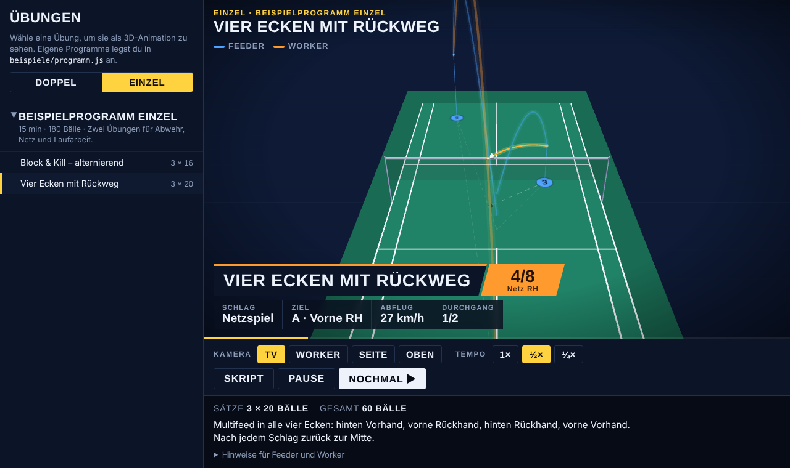

# Badminton-Drill-Animator

Badminton-Drills als 3D-Animation im Browser: Feld mit offiziellen Maßen, Federball-Flugbahnen mit echter Physik, Landepunkte, Beschriftungen und Video-Export als MP4.

Ein Drill wird als kleines JSON-Skript beschrieben (wer spielt welchen Schlag wohin), das Programm rechnet daraus die Flugbahnen aus und spielt sie ab.



## Was drin ist

| Seite | Wofür |
|---|---|
| [`studio/`](studio/index.html) | **Flugbahn-Studio**: einzelne Schläge ausprobieren (Ziel per Klick setzen), einen Drill als JSON bearbeiten und als MP4 exportieren (Hochformat, Querformat oder Quadrat, 30 oder 60 fps). |
| [`bibliothek/`](bibliothek/index.html) | **Multifeed-Bibliothek**: Trainingsprogramme mit mehreren Übungen, getrennt nach Doppel und Einzel. Unterstützt mehrere Bälle gleichzeitig in der Luft, zwei Worker und zwei Feeder. |
| [`engine.js`](engine.js) | Physik und Drill-Logik ohne Grafik, wird von der Bibliothek und von `tools/check.js` benutzt. |
| [`beispiele/programm.js`](beispiele/programm.js) | Ein selbst ausgedachtes Beispielprogramm mit drei Drills. |

## Starten

Es gibt keinen Build-Schritt. Am einfachsten startest du einen kleinen Webserver im Projektordner:

```bash
python3 -m http.server 8000
# dann http://localhost:8000 im Browser öffnen
```

Die Seiten funktionieren auch per Doppelklick direkt aus dem Dateisystem. three.js, die Schriften und `mp4-muxer` werden aus dem Internet (CDN) geladen.

Der MP4-Export nutzt WebCodecs. Das können aktuelle Versionen von Chrome, Edge und Safari.

## Online-Version

Bei jedem Push auf `main` prüft ein GitHub-Workflow (`.github/workflows/pages.yml`) alle Drills und veröffentlicht die Seiten auf GitHub Pages:
https://badmintonroa.github.io/Badminton-Animator/

Für einen eigenen Fork einmalig unter **Settings → Pages → Build and deployment → Source** „GitHub Actions“ auswählen.

## Das Drill-Skript

```json
{
  "name": "Block & Kill – alternierend",
  "format": "singles",
  "players": {
    "feeder": { "side": "A", "start": "mid_center" },
    "worker": { "side": "B", "start": "base" }
  },
  "tempo": { "pause_between_shuttles": 1.2 },
  "sequence": [
    { "by": "feeder", "shot": "smash",    "to": "B.mid_forehand",   "label": "Angriff VH" },
    { "by": "worker", "shot": "block",    "to": "A.front_center",   "label": "Block" },
    { "by": "feeder", "shot": "net_feed", "to": "B.front_forehand" },
    { "by": "worker", "shot": "net_kill", "to": "A.mid_center",     "label": "Kill!" }
  ],
  "repeat": 2
}
```

**Seiten:** `A` ist die vordere Hälfte (nah an der TV-Kamera), `B` die hintere. Der Feeder steht üblicherweise auf `A`.

**Zonen:** `A.` oder `B.` + Tiefe + Seite, z. B. `B.back_forehand`.

- Tiefe: `front`, `service` (Aufschlaglinie), `mid`, `back`
- Seite: `forehand`, `center`, `backhand`, optional mit `_wide` für die Seitenlinie (`B.front_forehand_wide`)
- `base` ist die Grundposition in der Feldmitte

Vorhand und Rückhand richten sich nach der Schlaghand des Workers auf der Seite (`"hand": "L"` für Linkshänder).

**Schläge:** `clear`, `smash`, `stick` (Halbsmash), `slice`, `drop`, `drive`, `lay_off`, `block`, `net`, `spin`, `net_feed`, `lift`, `flat_lift`, `push`, `serve`, `flick`, `net_kill`/`kill`, `feed` (Zuwurf) und `throw` (Wurf). Die Startwerte stehen in `SHOT_TYPES` in `engine.js`.

**Ablauf:**

- Ein Schlag nimmt automatisch den ankommenden Ball an, solange der noch im Spiel ist. Ein Kill beendet den Ballwechsel.
- `"new_shuttle": true` startet einen neuen Ball (Multifeed).
- `tempo.feed_after_hit` legt fest, wie viele Sekunden nach dem letzten Schlag der nächste neue Ball kommt. Ohne diesen Wert wartet der Feeder `pause_between_shuttles` Sekunden nach der Landung.
- `contact` überschreibt die Treffhöhe in Metern, `label` den angezeigten Text, `from` die Startzone.
- Mehrere Spieler einer Rolle: Schlüssel frei wählen (z. B. `worker_1`, `worker_2`) und `"role": "worker"` bzw. `"role": "feeder"` setzen.

## Eigene Programme

Lege eigene Drills und Programme in `beispiele/programm.js` an (oder kopiere die Datei und passe den `<script>`-Pfad in `bibliothek/index.html` an). Danach prüfen, ob alle Drills spielbar sind:

```bash
node tools/check.js
```

Das Skript rechnet jeden Drill durch und meldet z. B. Bälle, die nicht über das Netz kommen.

## Physik

Der Federball fliegt mit Schwerkraft und quadratischem Luftwiderstand (Endgeschwindigkeit etwa 6,8 m/s). Deshalb fällt er am Ende fast senkrecht, wie ein echter Ball. Für jeden Schlag sucht das Programm die Abfluggeschwindigkeit oder den Abflugwinkel, mit dem der Ball genau in der Zielzone landet und dabei über das Netz kommt.

Das Feld hat die offiziellen Maße: 13,40 × 6,10 m, Einzelfeld 5,18 m breit, Netz 1,55 m an den Pfosten und 1,524 m in der Mitte.

## Lizenz

Copyright (C) 2026 Jannis (badmintonroa). Lizenz: [GNU AGPL-3.0](LICENSE). Du darfst den Code frei nutzen, verändern und weitergeben. Wer eine veränderte Fassung weitergibt oder als Webseite für andere betreibt, muss den Quellcode seiner Änderungen ebenfalls unter der AGPL-3.0 veröffentlichen.

Die Beispiel-Drills in `beispiele/` sind frei erfunden und fallen unter dieselbe Lizenz.
